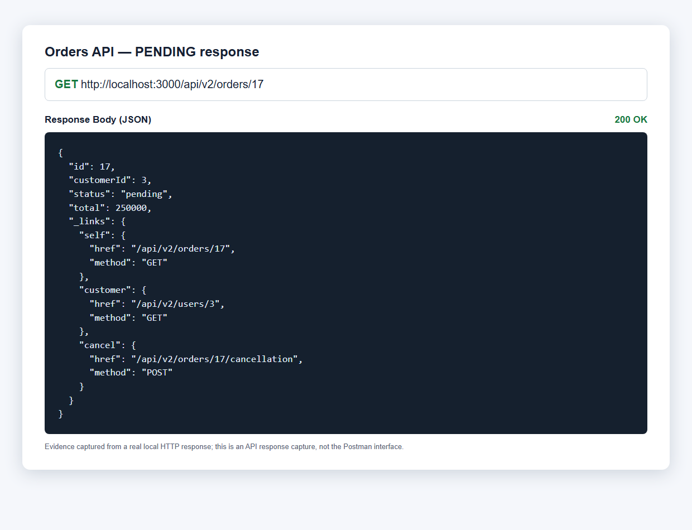
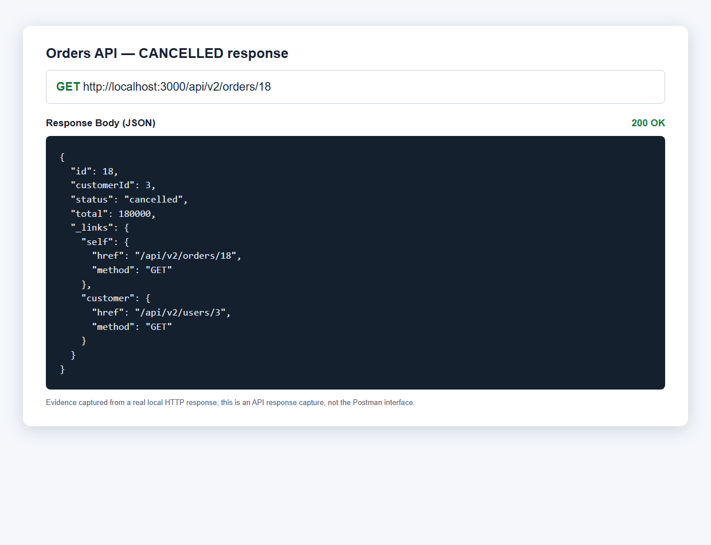

# REST API Level 3 — HATEOAS Orders

Bài tập Session 04: **API Design & Implementation in Express.js**.

## Mục tiêu

Xây dựng `GET /api/v2/orders/:id` trả thông tin đơn hàng kèm `_links` biểu diễn các hành động có thể thực hiện tiếp theo. Danh sách link phụ thuộc vào trạng thái của đơn hàng.

## Cài đặt và chạy

Yêu cầu: Node.js và npm.

```bash
npm install
node src/server.js
```

Server lắng nghe tại `http://localhost:3000`. Dữ liệu được lưu trong bộ nhớ, nên reset khi khởi động lại.

## Endpoints chính

| Method | Endpoint | Kết quả |
|---|---|---|
| GET | `/api/v2/orders/17` | 200 — đơn pending, có cancel link |
| GET | `/api/v2/orders/18` | 200 — đơn cancelled, không có cancel link |
| GET | `/api/v2/orders/999` | 404 — không tìm thấy đơn |
| GET | `/api/v2/orders/abc` | 400 — ID không hợp lệ |

### Trường hợp 1: pending

```http
GET /api/v2/orders/17
```

```json
{
  "id": 17,
  "customerId": 3,
  "status": "pending",
  "total": 250000,
  "_links": {
    "self": { "href": "/api/v2/orders/17", "method": "GET" },
    "customer": { "href": "/api/v2/users/3", "method": "GET" },
    "cancel": { "href": "/api/v2/orders/17/cancellation", "method": "POST" }
  }
}
```



### Trường hợp 2: cancelled

```http
GET /api/v2/orders/18
```

```json
{
  "id": 18,
  "customerId": 3,
  "status": "cancelled",
  "total": 180000,
  "_links": {
    "self": { "href": "/api/v2/orders/18", "method": "GET" },
    "customer": { "href": "/api/v2/users/3", "method": "GET" }
  }
}
```



Hai hình trên được tạo từ kết quả HTTP thực tế ở localhost, **không phải ảnh chụp giao diện Postman**.

## Vì sao `_links` giúp tiến tới Richardson Level 3?

**Level 2** dùng tài nguyên, các HTTP methods và status code một cách phù hợp. Client phải biết trước URL/hành động để thao tác với resource.

Ở **Level 3 (HATEOAS)**, response chứa thông tin hypermedia mô tả các hành động có sẵn và nơi thực hiện chúng. Trong bài này:

- `self` cho biết địa chỉ xem chính đơn hàng.
- `customer` cho biết địa chỉ tài nguyên khách hàng.
- `cancel` chỉ xuất hiện khi `status === "pending"`, để client biết API đang đề xuất hành động hủy.
- Khi `status === "cancelled"`, `cancel` biến mất, do đó client không còn được gợi ý hủy lần nữa.

Logic xây dựng link nằm tập trung trong `express-api-lab/utils/links.js` (hàm `buildOrderLinks`), không rải điều kiện theo trạng thái trong Express route. Đây là ví dụ minh họa đặc điểm HATEOAS mà đề yêu cầu, chưa phải một hệ thống hypermedia đầy đủ.

**Phạm vi hiện tại:** các link `customer` và `cancel` mới được xuất ra dưới dạng metadata. Chưa triển khai các endpoint đích `GET /api/v2/users/:id` và `POST /api/v2/orders/:id/cancellation`; cần triển khai nếu muốn nhấp/gọi những link đó thực sự hoạt động. Việc xuất link không thay thế xác thực và kiểm tra quyền phía server.

## Cấu trúc file liên quan

```text
session 04/
├── src/server.js                         # Express app và đăng ký router
├── express-api-lab/
│   ├── data/orders.js                    # Dữ liệu 2 đơn hàng
│   ├── routes/v2/orders.js              # GET /:id; 200/400/404
│   └── utils/links.js                   # Sinh _links theo trạng thái
├── tests/orders.test.js                 # Kiểm thử tự động
├── scripts/capture-evidence.js          # Sinh ảnh minh chứng từ HTTP response
└── screenshots/
    ├── pending.png
    └── cancelled.png
```

## Kiểm thử

Trong khi server đang chạy, từ thư mục `session 04`:

```bash
node --test tests/orders.test.js
```

Kết quả kiểm tra tại thời điểm chuẩn bị bài: **4 tests PASS, 0 FAIL**. Hai ảnh minh chứng đã được tạo từ response nhận được thực tế.

Để tạo lại ảnh (trên Windows có Microsoft Edge):

```bash
node scripts/capture-evidence.js
```

Ngoài ra có thể tạo hai GET request tương ứng trong Postman, kiểm tra status 200, sự xuất hiện của `_links.cancel` ở pending và sự vắng mặt của nó ở cancelled.
